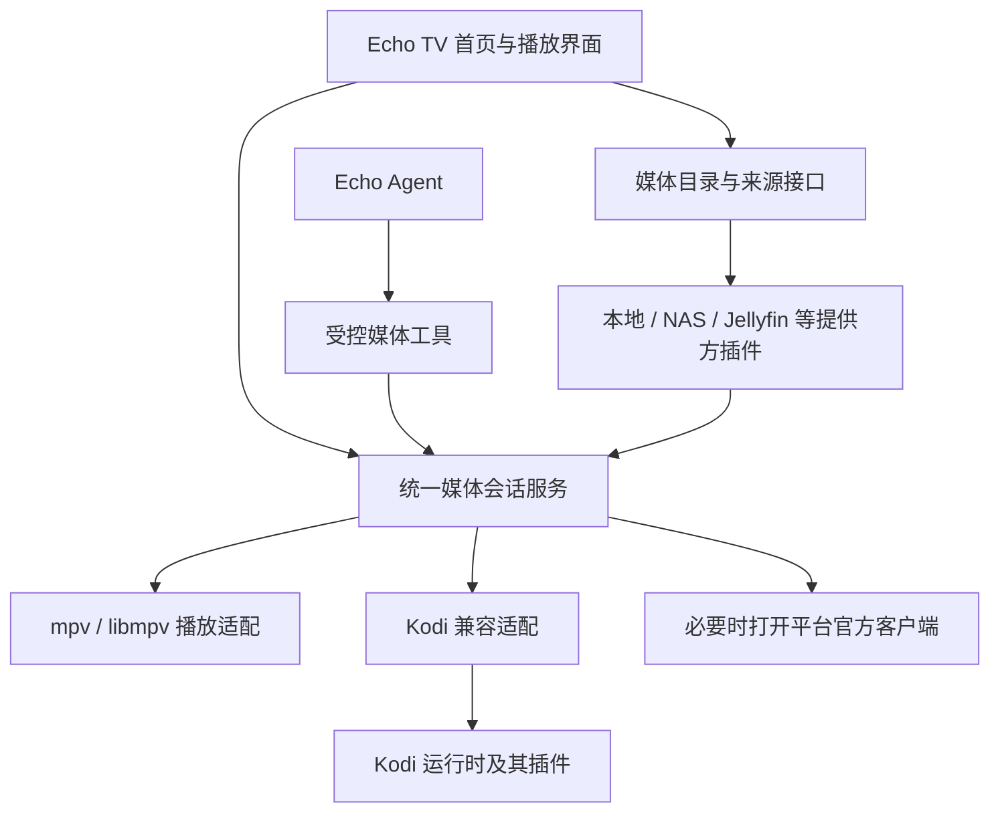

# Echo OS TV：大屏交互与媒体架构提案

初版日期：2026-11-05；更新：2026-11-06。用户已确认 Linux 与 Android TV 都需要，先做 Linux。Linux TV 交互预览已实现并在原生虚拟机验证；mpv/Kodi、流媒体提供方插件与 Android TV 原生适配尚未完成。当前功能和验收边界见 [TV 预览说明](tv-preview.md)。

## 产品定位

在 Echo OS Linux 上新增独立 TV 界面：遥控器操作的媒体首页，以及随时可呼出的 Echo Agent。桌面版与 TV 版共享账号、Agent、知识库和插件服务；分别维护适合鼠标和遥控器的界面。第一阶段采用 x86 Linux 主机接电视，并在现有虚拟机验证功能；下一阶段适配 Android TV。

Apple TV 提供视觉与交互参考：大幅内容封面、横向内容行、清晰焦点、远距离可读文字、少量稳定入口。保留 Echo 品牌，不使用 Apple 商标或其内容素材。TV 模式本身仍是 Echo OS，不是在 Apple TV 硬件上安装 Linux。

## 实施前的基础核对（2026-11-05）

| 层 | 已核对的现状 | TV 版需要补齐 |
| --- | --- | --- |
| Linux 桌面 | `frontend/src/app/desktop/page.tsx` 已有桌面、应用、Agent 和系统控制 | 独立 TV shell、启动会话选择、遥控器焦点系统 |
| 媒体库 | `frontend/src/app/apps/media/page.tsx` 使用 NAS 文件接口、视频索引与 HTML video 预览 | 海报/季集元数据、继续观看、收藏、统一播放状态 |
| 原生播放 | `deploy/core-apps/mimeapps.list` 将视频及部分音频关联到 Haruna | 可由 Echo 控制和观察的播放服务；文件关联不等于已有统一播放器 |
| Agent | `frontend/src/appliance/task-space.ts` 已有 `/api/task-runs/start`、任务投影和审批 | 大屏任务卡、语音/手机输入入口、媒体上下文及工具适配 |
| 插件 | `runtime/platform/plugins/plugin_base.py` 提供技能、API、生命周期与数据目录 | 媒体提供方协议、播放后端协议、Kodi 兼容适配和版本检查 |
| 视频理解 | `runtime/sensing/gateway/media_router.py` 为视频索引/理解接口 | 不能将其当作网络流播放服务；模型能力仍需各自验证 |

未发现已接入的 Kodi/libmpv 控制服务或 TV 焦点导航。上述结论来自本次检查的前端、原生应用配置和运行时模块，不代表运行中的机器已经安装了全部镜像组件。

## 页面和交互

顶部固定为「首页 / 影视 / 应用 / 搜索」，账户与设置合并为右上角入口。首页由精选大封面、继续观看、媒体来源、我的应用组成。没有内容时展示连接媒体来源的真实空状态，不填充虚构观看历史。

Agent 同时有首页入口和全局呼出动作。播放时展示侧边浮层；一般查询不强制退出播放。可表达「继续看昨天那部电影」「打开中文字幕」「找 NAS 中的旅行视频」。复杂任务显示简短进度卡和可展开详情。涉及账号授权、订阅或修改系统时保留明确操作反馈和必要确认。

TV 导航必须单靠方向键、确认、返回完成：

- 初始焦点明确；方向移动保持空间关系；按住方向键支持可控连发。
- 内容异步刷新、海报延迟加载或项目消失时，焦点仍落在可见的可操作元素。
- 关闭弹层、退出播放器、返回列表时，恢复来源卡片和滚动位置。
- 返回优先关闭弹层，再返回上级，首页不会意外退出系统。
- 焦点以轮廓、亮度和小幅缩放共同表达，不依赖鼠标悬停；支持减少动效。
- 文字按观看距离调整，界面按电视安全区布局；1080p 和 4K 分别检查。
- 首版使用键盘模拟遥控器。蓝牙遥控器、媒体键、HDMI-CEC、手机遥控及语音输入逐项适配，不能以键盘测试代替硬件验收。

## 播放与插件边界

建议先完成 mpv 播放适配，再增加可选 Kodi 适配。提供方负责内容目录、认证、搜索和解析播放资源；播放服务负责状态、暂停、跳转、音轨、字幕、恢复和错误反馈。UI 和 Agent 调用同一播放服务，避免两套状态不同步。

Linux 首版可用受控 mpv 子进程加本地 IPC 验证播放链路；独立窗口的焦点、浮层和返回体验要如实标记。达到统一播放界面需要原生 libmpv 渲染/窗口合成适配，不能把 Electron HTML video 当作完整原生播放方案。进程仅通过参数数组启动，IPC 限制本机访问，资源引用经后端验证。

Kodi 是完整媒体中心，其 Python/二进制插件依赖 Kodi 运行时，并非可直接加载进 Echo PluginHub 的通用库。兼容方式是安装受管理的 Kodi 运行时，通过 JSON-RPC 控制播放、读取媒体库和接收事件；单个插件的目录浏览、登录流程、播放解析及版本兼容须另做适配。首版可以跳转 Kodi 播放并返回 Echo；不能提前承诺所有 Kodi 插件都可在 Echo 内无缝展示。

### 建议协议（待实现）

- `MediaProvider`：`capabilities`、`list`、`search`、`detail`、`resolve`、`authStatus`。登录方式明确为设备码、网页或其他受支持流程。
- `PlaybackRequest`：媒体项 ID、提供方 ID、所需后端、流类型、有效期、后端凭据引用、字幕/音轨与可选续播位置。敏感令牌不放进前端日志或模型提示。
- `PlaybackSession`：`idle/loading/playing/paused/buffering/ended/error`、当前时间、时长、可跳转范围、音轨/字幕、错误原因。直播与点播分别处理。
- 媒体工具：`media.search`、`media.play`、`media.pause`、`media.seek`、`media.select_subtitle`。工具描述和返回结果均来自真实能力。
- 播放历史按用户与媒体项隔离；升级或卸载提供方默认保留收藏/进度，移除授权和保留数据分别说明。

插件沿用现有安装、启停、升级与保留数据卸载的机制，但需增加媒体能力注册和播放会话释放。Echo 当前的进程内插件机制不自动提供恶意插件隔离；第三方来源插件的执行隔离、网络域名/文件权限及更新校验应独立实现和验证。

## 内容与设备能力

优先顺序：本地/NAS 文件 → Jellyfin 等个人媒体库 → 获授权的 HLS/DASH/直播源 → 逐个验证 Kodi 插件或平台客户端。

Kodi InputStream Adaptive 支持 HLS、MPEG-DASH 等自适应流及部分 DRM 集成，但支持某种 DRM 不代表已经获得平台播放权限、账号授权或高清设备认证。官方资料说明 Widevine CDM 在部分系统上需另行安装；应按实际平台和发行条件确认。没有验证前，不承诺全部平台、4K、HDR、杜比视界或音频直通。

虚拟机适合验证导航、Agent、插件生命周期、普通视频和断线恢复。硬件解码、4K 帧率、HDR、HDMI 音频/CEC、遥控器唤醒与长时间播放应在目标实体主机和电视上验收。Android TV 可以复用部分界面/协议，但原生播放、输入、账号及平台认证须另行适配。

## 实施与放行

1. TV 交互样机：独立入口、首页/媒体详情/Agent 浮层，键盘方向键完整走通。保留桌面版入口与原有工作流。
2. Linux 可运行首版：真实 NAS 内容、mpv 播放、字幕音轨/续播、真实 Agent 媒体工具；统一显示断网、令牌失效、播放器退出和服务不可用。
3. 来源与兼容扩展：个人媒体库插件、Kodi 兼容后端、插件生命周期；根据具体平台验证 DRM/客户端回退。
4. 实体设备验收：遥控器/CEC、音视频规格、多用户、休眠唤醒和稳定性。通过后再生成 TV 专用安装与启动配置。

自动化至少覆盖：无鼠标导航及无焦点陷阱；弹层返回与焦点恢复；账号切换不串播放历史；插件安装/停止/升级/卸载保留数据；真实短片暂停/跳转/字幕/续播；网络断开重连；播放器崩溃恢复；Agent 命令与手动操作状态一致；桌面模式原有回归。真实素材测试、协议模拟测试、虚拟机测试与硬件实测必须分开记录，未验证项不放行。

## 官方资料

- Apple，Designing for tvOS：<https://developer.apple.com/design/human-interface-guidelines/designing-for-tvos>。本次读取官方 Markdown 版本，核对焦点、远距离观看、输入与多用户设计。
- mpv 官方手册：<https://mpv.io/manual/stable/>。核对外部控制与 libmpv 集成建议。
- Kodi JSON-RPC：<https://kodi.wiki/view/JSON-RPC_API>。核对第三方应用控制接口与事件传输。
- Kodi InputStream Adaptive：<https://kodi.wiki/view/Add-on:InputStream_Adaptive>。
- Kodi DRM 集成：<https://github.com/xbmc/inputstream.adaptive/wiki/Integration-DRM>。

实施按阶段进行，不能将设计中的规划能力计入当前版本验收。
